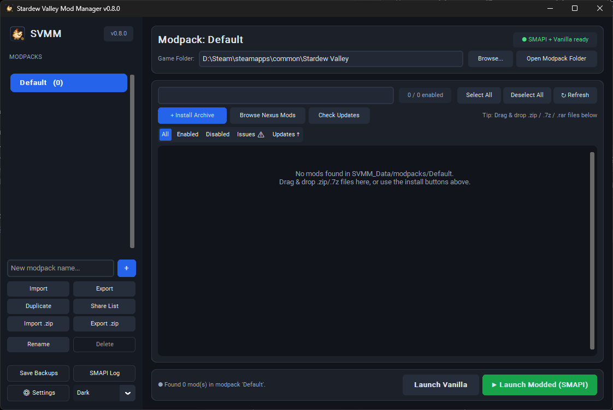
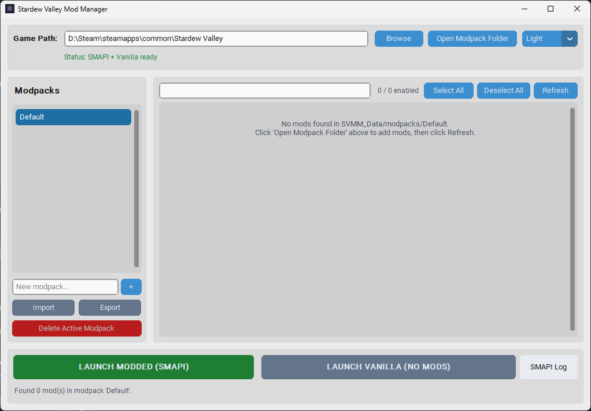

<p align="center">
  
</p>

# Stardew Valley Mod Manager (SVMM)

[](https://github.com/smanedn/stardew_mod_manager/actions/workflows/ci.yml)
[](LICENSE)
[](https://www.python.org/downloads/)
[](https://github.com/smanedn/stardew_mod_manager/releases)

A lightweight desktop mod manager for **Stardew Valley** built with Python and `customtkinter`. Each modpack has its own dedicated folder, and profile switching uses OS-level directory junctions/symlinks so mods swap instantly without copying files.

## Features

- **Per-Modpack Folders:** Keep each modpack's mods isolated under `SVMM_Data/modpacks/<ModpackName>/`.
- **Instant Profile Switching:** Rebuilds `SVMM_Data/profiles/<ProfileName>/` and links `Stardew Valley/Mods` using directory junctions (`mklink /J` on Windows) or symlinks (macOS/Linux, experimental) with zero file copying.
- **Safe Vanilla Launch:** Unlinks `Stardew Valley/Mods` and launches the base game (`Stardew Valley.exe`) without touching your mod files. Any pre-existing unmanaged `Mods` folder is safely backed up to `Mods_Backup`.
- **Tolerant SMAPI Manifest Parser:** Reads `manifest.json` with UTF-8 BOM (`utf-8-sig`) support and safely handles comments and trailing commas.
- **Dependency & Conflict Warnings:** Flags missing required `Dependencies` and duplicate `UniqueID`s (`⚠` + hover tooltip) and prompts for confirmation before launching SMAPI.
- **Safe `.zip` Mod Installer:** Install single or multi-mod `.zip` archives directly into the active modpack with zip-slip path traversal protection.
- **Mod Update Checker:** Checks `GitHub:owner/repo` `UpdateKeys` in the background with caching (`SVMM_Data/update_cache.json`) and graceful offline handling (optional `github_token` in `SVMM_Data/config.json`).
- **Profile Import / Export / Duplicate & Theme Support:** Share or duplicate profile JSONs, switch between Dark / Light / System themes, and open `SMAPI-latest.txt` directly from the launch bar.
- **Double-Click Ready:** Running `main.py` directly on Windows automatically re-launches using `.venv` if present.

## Screenshots

| Dark Mode | Light Mode |
| --- | --- |
|  |  |

## Platform Support

| Platform | Status | Linking Mechanism & Permissions |
| --- | --- | --- |
| **Windows** | **Tested** (Windows + Python 3.13; CI runs Python 3.11 & 3.13) | Uses NTFS **Directory Junctions** (`cmd /c mklink /J`). Works out of the box without Administrator privileges. |
| **macOS** | **Experimental** (untested on hardware) | Uses POSIX **symbolic links** (`os.symlink(..., target_is_directory=True)`). Standard user permissions are sufficient on APFS/HFS+. |
| **Linux** | **Experimental** (untested on hardware; unit tests run in CI) | Uses POSIX **symbolic links** (`os.symlink(..., target_is_directory=True)`). Requires a POSIX filesystem supporting symlinks. |

## Tech Stack

- **Language:** Python 3.10+
- **GUI:** [`customtkinter`](https://github.com/TomSchimansky/CustomTkinter)
- **Backend:** Python Standard Library (`json`, `pathlib`, `subprocess`, `os`, `shutil`, `stat`)

## Download

Pre-built Windows executables are available on the [Releases page](https://github.com/smanedn/stardew_mod_manager/releases/latest):

1. Download `SVModManager-vX.Y.Z-windows-x64.zip` and extract `SVModManager.exe` into its own folder.
2. Double-click `SVModManager.exe` to launch (it stores `SVMM_Data/` right next to the executable).
3. If Windows SmartScreen appears for an unsigned binary, click **More info → Run anyway**.

## Prerequisites

- **Python 3.10+**
- **Stardew Valley** installed locally
- **[SMAPI](https://smapi.io/)** installed in your Stardew Valley directory (required for modded launches)

## Local Setup & Running

1. **Clone the repository:**
   ```bash
   git clone https://github.com/smanedn/stardew_mod_manager.git
   cd stardew_mod_manager
   ```

2. **Create and activate a virtual environment:**
   ```powershell
   python -m venv .venv
   .\.venv\Scripts\Activate.ps1
   ```
   *(On macOS/Linux: `python3 -m venv .venv && source .venv/bin/activate`)*

3. **Install dependencies:**
   ```bash
   pip install -r requirements.txt
   ```

4. **Run the application:**
   - **Terminal:**
     ```powershell
     .\.venv\Scripts\python.exe main.py
     ```
   - **Windows File Explorer:** Double-click `main.py` (it automatically detects and uses `.venv`).

5. **Configure in the UI:**
   - Click **Browse** to select your Stardew Valley installation folder (saved locally to `SVMM_Data/config.json`).
   - Click **Open Modpack Folder** to drop mod folders into the active modpack (`SVMM_Data/modpacks/<ProfileName>/`), then click **Refresh** (`F5`).
   - Check the mods you want enabled and click **LAUNCH MODDED (SMAPI)** or **LAUNCH VANILLA (NO MODS)**.

> **Note:** This project does not use API keys, databases, or `.env` files. All user configuration is stored locally in `SVMM_Data/config.json` (ignored by Git).

## Project Structure

```text
stardew_mod_manager/
├── main.py                  # Entry point, .venv bootstrap, and app orchestrator
├── requirements.txt         # Runtime dependency (customtkinter)
├── requirements-dev.txt     # Dev dependencies (pytest, ruff)
├── pyproject.toml           # Ruff and pytest configuration
├── .gitignore               # Ignores .venv, __pycache__, SVMM_Data, .env*, OS/IDE files
├── assets/
│   ├── logo.png             # Application icon and README logo
│   ├── logo.ico             # Windows titlebar icon
│   └── screenshots/         # Screenshots for documentation
├── src/
│   ├── __init__.py
│   ├── core/
│   │   ├── __init__.py
│   │   ├── config.py        # ConfigManager, validation, and profile import/export
│   │   ├── mod_scanner.py   # Mod folder scanner and SMAPI manifest.json parser
│   │   ├── mod_manager.py   # Profile junction/symlink sync and Mods_Backup handling
│   │   └── launcher.py      # Path validation, SMAPI log locator, and game launcher
│   └── ui/
│       ├── __init__.py
│       ├── theme.py         # Light/dark design tokens and typography
│       ├── top_bar.py       # Game path bar, validation status, and theme switcher
│       ├── profile_sidebar.py # Modpack list, create/delete, and import/export
│       ├── mod_list.py      # Debounced search, cached mod rows, and counter badge
│       └── launch_bar.py    # Modded/Vanilla launch buttons, SMAPI log, and status bar
└── tests/                   # Unit tests for core modules
```

## Roadmap

- [x] Per-modpack folder isolation (`SVMM_Data/modpacks/<ProfileName>/`)
- [x] Zero-copy Windows directory junction syncing & safe `Mods_Backup`
- [x] Tolerant SMAPI `manifest.json` parser (BOM, comments, trailing commas)
- [x] Dark / Light / System theme switcher & profile import/export/duplicate
- [x] Ruff linting, `pytest` suite, and GitHub Actions CI
- [x] Dependency/conflict hints using `UniqueID` and `Dependencies` in `manifest.json`
- [x] Safe `.zip` mod installation and `UpdateKeys` update checker (`GitHub:owner/repo`)
- [ ] Recursive scanning for nested modpacks containing subfolder `manifest.json` files
- [ ] Additional update providers (e.g. Nexus Mods with optional user API key)
- [x] Windows `.exe` release workflow via PyInstaller on `v*` tags
- [ ] Verified macOS and Linux runtime testing

## Contributing

Contributions are welcome! Please read [CONTRIBUTING.md](CONTRIBUTING.md) before opening a pull request.

## License

This project is licensed under the **MIT License** — see [LICENSE](LICENSE) for details.
